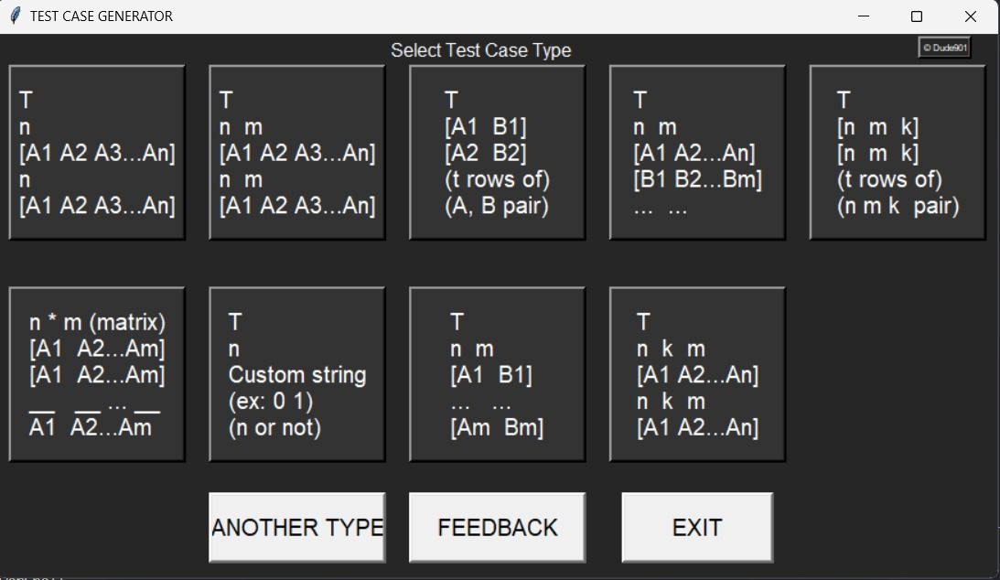
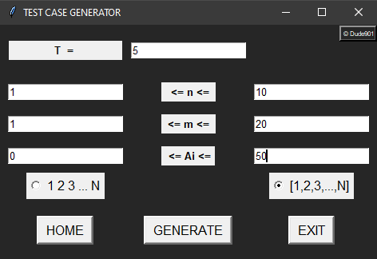
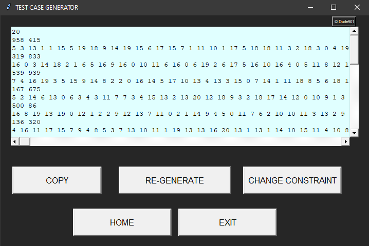
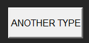

# [Test-case-generator](https://tanmay-901.github.io/test-case-generator/) [](https://twitter.com/intent/tweet?text=Generate%20different%20types%20of%20test%20cases%20using%20Test%20Case%20Generator,%20an%20Open-source%20tool%20to%20create%20test%20cases%20of%20the%20desired%20type%20to%20use%20in%20Competitive%20coding,%20using%20a%20simple,%20easy-to-use%20interface.&url=https://tanmay-901.github.io/test-case-generator/)
#### Generate test cases for Competitive Coding -> [Zip file](https://github.com/Tanmay-901/test-case-generator/raw/master/test_case.zip)
* Extract the zip file -> goto dist folder -> run test_case.exe (keep all the files at same location)
* For more convenience (recomended),
  1. (After extraction) inside dist folder, right click on 'test_case.exe'.
  2. click on `pin to start`, now you can directly use the tool from start menu.
-------------------------------
<p align="center">
<a href="https://github.com/Tanmay-901/test-case-generator/raw/master/test_case.zip" target="blank">

<a href="https://github.com/Tanmay-901/test-case-generator/blob/master/LICENSE" target="blank">

</a>
<a href="https://github.com/Tanmay-901/test-case-generator/fork" target="blank">

</a>
<a href="https://github.com/Tanmay-901/test-case-generator/stargazers" target="blank">

</a>
<a href="https://github.com/Tanmay-901/test-case-generator/issues" target="blank">

</a>
<a href="https://github.com/Tanmay-901/test-case-generator/pulls?q=is%3Apr+is%3Aclosed" target="blank">

<a href="https://github.com/Tanmay-901?tab=followers" target="blank">

</a>

</p>

<p align="center">
    <a href="https://github.com/Tanmay-901/test-case-generator/blob/master/public/README.md">Detailed Instructions</a>
    ·
    <a href="https://github.com/Tanmay-901/test-case-generator/issues/new?assignees=&labels=&template=bug_report.md&title=BUG">Report Bug</a>
    ·
    <a href="https://github.com/Tanmay-901/test-case-generator/issues/new?assignees=&labels=&template=feature_request.md&title=Feature+request">Request Feature</a>
</p>

# 👋 Introducing `Test Case Generator`  [](https://www.codetriage.com/tanmay-901/test-case-generator)
<p align="center">
<a href="github.com/Tanmay-901/test-case-generator">
        
    </a></p>


`Test Case Generator` is an open-source tool to create Test cases of the desired type to use in Competitive coding using a simple, easy-to-use interface. You can create arrays, strings, and char patterns and use a variety of handy features like copy, regenerate, and change constraints.

<!--## 💘 Support project - [](https://www.buymeacoffee.com/dude901).-->

Liked it? Please give a ⭐️ to <b>Test Case Generator</b> to build its community stronger.


---

# 🔥 Features
`Test Case Generator` comes with a bundle of features already. You can do the followings with it,
## ✨ Select space separated / comma separated format
<p align="center">
        
</p>

## 🎿 Copy
 - No need to manually copy the output, simply use this button

## 🔢 Regenerate
 - Generate test cases again and again for the given constraints with single click.

## 🏗️ Change constraints
 - Directly go to the constraints screen to make a quick change in constraints or leave them with default values / recommended constraints for better evaluation
<p align="center">
        
</p>


## 📢 Suggest more test case formats
- You can get more test cases added by creating a test case addition request.
<p align="center">
        
</p>

## 🌳 Tree Test Cases
 - Generate random tree structures with `n` nodes and `n-1` edges
 - Uses the [Prüfer sequence](https://en.wikipedia.org/wiki/Pr%C3%BCfer_sequence) algorithm to guarantee valid, connected, acyclic trees
 - Output format:
 ```
 T
 n
 u1 v1
 u2 v2
 ...
 ```

# 🍔 Built With
- [Python](https://python.org/): High-level general-purpose programming language
- [Tkinter](https://docs.python.org/3/library/tkinter.html): Standard Python interface to the Tk GUI toolkit

# 🛡️ License
This project is licensed under the GNU GPLv3 License - see the [`LICENSE`](LICENSE) file for details.

# 🦄 Upcoming Features
`Test Case Generator` has all the potentials to grow further. Here are some of the upcoming features planned(not in any order),

- ✔️ Support for Test cases for larger constraint values is being worked upon.
- ✔️ New test case types are being added on request.
- ✅ Trees - Implemented! Random tree generation using Prüfer sequence algorithm
- ✔️ Graphs, Linked-list are open for contributions

If you find something is missing, `Test Case Generator` is listening. Please create a feature request [from here](https://github.com/Tanmay-901/test-case-generator/issues/new/choose).

# 🤝 Contributing to `Test Case Generator`
Any kind of positive contribution is welcome! Please help us to grow by contributing to the project.

If you wish to contribute, you can work on any features [listed here](https://github.com/Tanmay-901/test-case-generator#-upcoming-features) or create one on your own. After adding your code, please send us a Pull Request.

> Please read [`CONTRIBUTING`](CONTRIBUTING.md) for details on our [`CODE OF CONDUCT`](CODE_OF_CONDUCT.md), and the process for submitting pull requests to us.

## 🙏 Many Thanks to all the `Stargazers` who has supported this project with stars(⭐)
[](https://github.com/Tanmay-901/test-case-generator/stargazers)

We all need support and motivation. `Test Case Generator` is not an exception. Please give this project a ⭐️ to encourage and show that you liked it. Don't forget to leave a star ⭐️ before you move away.

---

<h3 align="center">
A ⭐️ to <b>Test Case Generator</b> is to build its Use Case 💪 stronger.
</h3>
